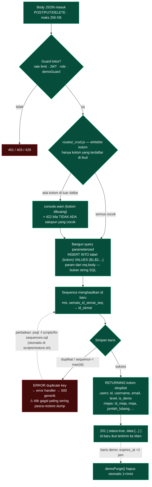
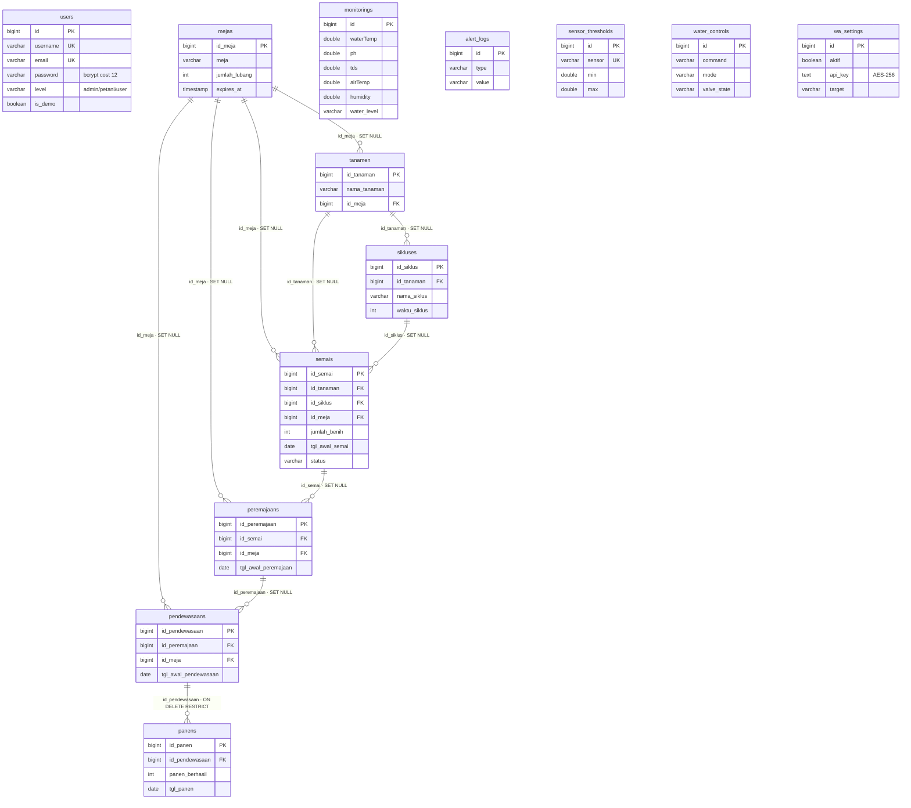

# DIAGRAM ALUR BACKEND — GARAP

Tiga diagram Mermaid untuk memahami backend GARAP (Express 4 + PostgreSQL 17).
Nama tabel & kolom diambil langsung dari `database/schema.sql` (13 tabel domain, 10 FK).
Render otomatis di GitHub / VS Code / Typora.

---

## 1. Arsitektur umum — dari klien sampai database

```mermaid
flowchart LR
    subgraph KL ["KLIEN"]
        B["Browser SPA<br/>React · :5173<br/>Authorization: Bearer JWT"]
        F["Flutter / polling<br/>GET /api/latest-sensor tiap 5 dtk"]
        E["ESP32<br/>POST /api/save-sensor<br/>header X-API-KEY"]
    end

    subgraph EX ["EXPRESS — src/index.js"]
        G1["Guard 1 · body JSON<br/>maks 256 KB → 400 bila rusak"]
        G2["Guard 2 · header keamanan<br/>nosniff · DENY · no-store"]
        G3["Guard 3 · rate limit / IP<br/>GET 300 · tulis 60 · login 10 → 429"]
        G4["Guard 4 · auth<br/>JWT (401) · role (403) · X-API-KEY (403)"]
        RT["Layer routes — 12 modul<br/>auth · monitoring · dashboard · tanam ·<br/>master · tahap · watercontrol · laporan ·<br/>user · profil · notifWa"]
        G1 --> G2 --> G3 --> G4 --> RT
    end

    subgraph CA ["CACHE — src/cache.js (in-memory TTL)"]
        C1["latest-sensor<br/>2 detik"]
        C2["dashboard<br/>5 detik"]
        C3["thresholds<br/>60 detik"]
    end

    subgraph DB ["DATABASE — src/db.js"]
        POOL["Pool pg<br/>max 50 koneksi<br/>timeout 10 dtk"]
        SQL["q() / one()<br/>SQL parameterized $1,$2"]
        PG[("PostgreSQL 17<br/>vertonik_smartfarm<br/>13 tabel domain · 35 index")]
        POOL --> SQL --> PG
    end

    B & F & E --> G1
    RT -->|"baca data"| CA
    CA -->|hit| RESP["Respons JSON<br/>200 / 201"]
    CA -->|miss| POOL
    RT -->|"tulis data"| POOL
    RT --> RESP
    PG -.->|"isi ulang cache"| CA

    classDef kl fill:#083344,stroke:#22d3ee,color:#fff
    classDef gd fill:#450a0a,stroke:#fb7185,color:#fff
    classDef rt fill:#064e3b,stroke:#34d399,color:#fff
    classDef db fill:#2e1065,stroke:#a78bfa,color:#fff
    class B,F,E kl
    class G1,G2,G3,G4 gd
    class RT,C1,C2,C3,RESP rt
    class POOL,SQL,PG db
```

**Penjelasan:** setiap klien melewati 4 guard berurutan sebelum masuk ke layer routes;
routes yang butuh data mengecek cache dulu (2/5/60 detik) baru jatuh ke pool koneksi
PostgreSQL, sehingga polling ribuan klien hampir tidak membebani database.

---

## 2. Jalur TULIS — dari body JSON sampai baris tersimpan

**Penjelasan:** kolom difilter whitelist dulu (kolom tak dikenal dibuang + dicatat log), lalu
di-INSERT memakai parameter $1,$2 — id datang dari sequence, dan `RETURNING` daftar kolom
eksplisit (tanpa `password`/`api_key`) yang dikirim balik. Satu titik gagal diketahui:
bila **sequence < max(id)** (terjadi setelah restore dump tanpa `fix-sequences`) →
`duplicate key` → **500**.

---

## 3. Relasi tabel (ERD) — 13 tabel, 10 foreign key

**Penjelasan:** rantai utamanya `mejas → tanamen → sikluses → semais → peremajaans →
pendewasaans → panens`; 9 dari 10 relasi memakai `SET NULL` (hapus induk → tautan putus,
data anak tetap), dan `panens → pendewasaans` memakai **`RESTRICT`** — pendewasaan tidak
bisa dihapus selama masih ada panen, karena panen adalah data historis.

> **⚠ Catatan penting (beda dengan instruksi awal):** relasi `panens → pendewasaans`
> semula `ON DELETE CASCADE`, tetapi **sudah diubah ke `RESTRICT`** lewat migrasi
> `database/migrations/2026-10-17_panens_fk_restrict.sql` (tugas perbaikan sebelumnya,
> handler DELETE kini membalas `409` yang ramah). Diagram di atas menampilkan kondisi
> **terkini**. Bila memang mau dikembalikan ke CASCADE, jalankan migrasi balikannya dan
> saya sesuaikan diagramnya.

**Enam tabel tanpa FK:** `users`, `monitorings`, `alert_logs`, `sensor_thresholds`,
`water_controls`, `wa_settings` (berdiri sendiri; data perangkat dihubungkan lewat
rancangan `devices` — lihat `docs/ARSITEKTUR_PI_2ESP32.md`).
