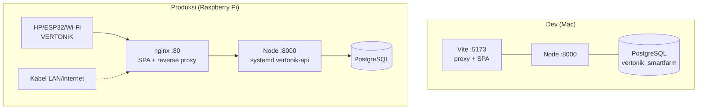

# Rancangan Backend — GARAP (as-is)

Dokumen ini memetakan **backend yang ada saat ini** (`backend-nodejs/`, Node.js/Express +
PostgreSQL) sebagai dasar pengembangan berikutnya. Rute 1:1 dengan kontrak Laravel lama
(lihat `BACKEND_ANALYSIS.md`).

---

## 1. Ringkasan Sistem

| Aspek | Keputusan |
|---|---|
| Runtime | Node.js (CommonJS) + Express 4 |
| Database | PostgreSQL 17 (`pg` pool, 50 koneksi) |
| Autentikasi | JWT HS256 (12 jam) + bcrypt cost 12 |
| Enkripsi at-rest | AES-256-GCM (baru) / AES-256-CBC+HMAC (legacy Laravel) |
| Output | **JSON-only** — tanpa HTML, tanpa stack trace |
| Jaringan | Bind `127.0.0.1` saja — diakses via proxy frontend (Vite dev / nginx) |
| Dependensi | **4 saja**: express, pg, bcryptjs, jsonwebtoken |
| Prinsip | Route fixed · error generik · rahasia hanya di `.env` & DB terenkripsi |

---

## 2. Arsitektur Tingkat Tinggi

```mermaid
flowchart LR
    subgraph Klien
        B[Browser Web React<br/>same-origin] & H[HP Flutter] & E[ESP32]
    end
    subgraph "Proxy (tanpa tahu isi)"
        V[Vite dev :5173] / N[nginx :80<br/>di Raspberry Pi]
    end
    subgraph "Backend Node.js — 127.0.0.1:8000"
        MW["Middleware pipeline<br/>header · 204-blank · rate-limit<br/>purge demo"] --> RT["Router (12 modul)"]
        RT --> AUTH["auth.js<br/>JWT · role · API-key"]
        AUTH --> DB[("PostgreSQL<br/>12 tabel + 8 index")]
        RT --> CACHE[("cache.js TTL<br/>2s/5s/60s")]
        RT --> CRYPTO[("crypto.js<br/>AES-256")]
    end
    B & H --> V & N
    E --> N
    V & N --> MW
```

**Aturan navigasi vs API** (dipakai identik di Vite & nginx): request dengan
`Sec-Fetch-Mode: navigate` = browser membuka halaman → SPA. Selain itu (fetch/curl/ESP32)
→ API. Backend sendiri membalas navigasi dengan **204 kosong** (tanpa output).

---

## 3. Peta Modul (`src/`)

| File | Peran |
|---|---|
| `index.js` | Pipeline middleware, mount route, 404/error handler, server HTTP(S) + tuning |
| `config.js` | Baca `.env` sederhana (tanpa dependensi): port/host/DB/JWT/APP_KEY/API-key |
| `auth.js` | `signToken`/`requireAuth`/`requireRole`/`verifyLogin`/`publicUser`/`demoPurge`/`requireApiKey` |
| `db.js` | Pool PostgreSQL (max 50, timeout 10s, handler error anti-crash) |
| `crypto.js` | Enkripsi at-rest: GCM (format `gcm.…`) + dekripsi legacy Laravel |
| `cache.js` | Cache TTL in-memory (cap 5000 key, auto-prune) |
| `rateLimit.js` | Pembatas per-IP (window 1 menit, prune 30 dtk, cap 50k IP) |
| `routes/_crud.js` | Factory CRUD generik (whitelist tabel/kolom → parameterized) |

### Modul route

| Modul | Mount | Akses |
|---|---|---|
| `auth.js` | `/` | publik (`/`, `/login`, `/logout`) |
| `monitoring.js` | `/api` (ESP32, `X-API-KEY`) + `/monitoring` | campur publik/terproteksi |
| `dashboard.js` | `/dashboard` | semua role |
| `tanam.js` | `/tanam` | semua role |
| `profil.js` | `/profil` | semua role |
| `watercontrol.js` | `/watercontrol` | admin + demo |
| `laporan.js` | `/laporan` | admin + demo |
| `notifWa.js` | `/notifikasi-wa` | admin + demo |
| `user.js` | `/user` | admin + demo |
| `master.js` | `/` (`/meja`, `/tanaman`, `/siklus`, `/ambang`) | guard per sub-route |
| `tahap.js` | `/` (`/semai`, `/peremajaan`, `/pendewasaan`, `/panen`) | guard per sub-route |

---

## 4. Pipeline Request (urutan eksekusi)

```
1. express.json (256 KB) + urlencoded
2. Header keamanan (nosniff, DENY, no-referrer, no-store) + x-powered-by off
3. Navigasi browser?        → 204 kosong (backend tanpa tampilan)
4. Rate limit: GET/HEAD 300/menit · login 10/menit · tulis 60/menit (per IP)
5. demoPurge()              → hapus data demo lewat 1 jam (tanpa FK error)
6. Router (guard JWT + role per mount)
7. 404 JSON generik         → { message: "The route … could not be found." }
8. Error handler            → 400 (JSON rusak) / 500 generik — TANPA stack
```

---

## 5. Peta Route (kontrak fixed)

### Autentikasi & publik
| Method | Path | Keterangan |
|---|---|---|
| GET | `/` , `/login` | info endpoint → JSON (navigasi → 204) |
| POST | `/login` | `{username,password}` → `{status,token,user,redirect}` · 422 = salah |
| GET | `/logout` | stateless (client buang token) |

### ESP32 (header `X-API-KEY`, timing-safe)
| POST | `/api/save-sensor` | **1 round-trip CTE**: anti-duplikat + insert + state katup + reset AUTO |
| GET | `/api/latest-sensor` | `{is_online, seconds_ago, anomalies, sensor, water_control}` (cache 2 dtk) |
| GET | `/api/get-thresholds` | ambang sensor (cache 60 dtk) |
| POST | `/api/notif-hardware` | peringatan hardware → alert_logs |

### Data inti (JSON)
| Kelompok | Route utama |
|---|---|
| Dashboard | `GET /dashboard` (cache 5 dtk) — koneksi, 6 metrik, pipeline 4 tahap, rata-rata, alert |
| Monitoring | `GET /monitoring/chart-data` (array 288 titik) · `GET/POST /monitoring/saveAlert` · `GET /monitoring/tarik/csv` |
| Siklus | `GET|POST /tanam`, batch `/{semai,peremajaan,pendewasaan,panen}/batch/:id`, CSV `/siklus/csv` |
| Water control | `GET /watercontrol/status` · `POST setMode/valve/command` (admin+demo) |
| Laporan | `GET /laporan` (CTE per bulan) · `GET /laporan/csv` |
| Master (CRUD) | `/meja`, `/tanaman`, `/siklus`, `/ambang` |
| Tahap (CRUD) | `/semai`, `/peremajaan`, `/pendewasaan`, `/panen` |
| Sistem | `/user` (admin+demo) · `/profil` · `/notifikasi-wa` (api_key hanya tersamar) |

---

## 6. Model Data (PostgreSQL)

```
users ─┬─< semais ──> mejas ──> tanaman ──< sikluses
       │     └─< peremajaans / pendewasaans / panens
       └── wa_settings (api_key AES-256), sessions
monitorings      ← tulisan ESP32 (index: created_at DESC)
alert_logs       ← alert sensor/hardware (index: created_at, type+value)
sensor_thresholds← ambang perangkat (sensor, min, max)
water_controls   ← mode/valve/command (1 baris dominan)
```
**8 index**: `monitorings(created_at DESC)` · `alert_logs(created_at DESC, type+value)` ·
`semais(status, tgl_awal_semai)` · `peremajaans/pendewasaans/panens(tanggal)` —
semua query grafik/laporan memakai index scan (0,7 ms @ 100k baris).

---

## 7. Lapisan Keamanan

| # | Kontrol | Implementasi |
|---|---|---|
| 1 | Password | bcrypt cost 12 (kompatibel `$2y$`) |
| 2 | Sesi | JWT HS256, 12 jam, klaim minimal (sub/username/level/demo/exp) |
| 3 | Otorisasi | `requireAuth` + `requireRole(all/admin+demo/petani)` per mount |
| 4 | Brute force | rate limit login 10/menit/IP → 429 + Retry-After |
| 5 | Anti-spam | GET 300 · tulis 60 per menit/IP (env: RATE_LIMIT_VIEW/WRITE/LOGIN, OFF=1) |
| 6 | API hardware | `X-API-KEY` timing-safe (`crypto.timingSafeEqual`) |
| 7 | SQL injection | 100% parameterized; nama tabel/kolom dari whitelist konfigurasi |
| 8 | Enkripsi at-rest | GCM (IV acak 12B + auth tag) / legacy CBC+HMAC, kunci `APP_KEY` |
| 9 | Anti-enumeration | pesan login generik "Username / Password salah." |
| 10 | Output | error generik tanpa stack/SQL/path; `password` tak pernah dibalik |
| 11 | Transport | bind localhost; HTTPS opsional (`HTTPS=1`, self-signed) |
| 12 | Batas | body 256 KB; header `nosniff/DENY/no-referrer/no-store` |

---

## 8. Desain Kinerja (teruji)

| Teknik | Detail | Bukti |
|---|---|---|
| Cache TTL | latest-sensor 2 dtk · dashboard 5 dtk · thresholds 60 dtk | polling 1000 user → ~0 query/dtk |
| CTE tunggal | save-sensor: 4 query → **1 round-trip** | 0 error @ 7.000+ RPS |
| Index | 8 index (lihat §6) | chart @100k baris = 0,69 ms |
| Pool | 50 koneksi, timeout 10s, auto-reconnect | 141.359 req/20 dtk, p95 233 ms |
| Tuning server | keepAlive 65s · headers 70s · request 30s | 0 error server (100% HTTP 200) |

---

## 9. Deployment


- Dev: `jalankan-local.sh` / proses lokal · Produksi: systemd + nginx (`deploy-pi/`)
- Update produksi: `./scripts/pi update` (build → rsync → restart) — `.env` tak tertimpa
- Mode AP: `vertonik-hotspot` (NetworkManager, `10.42.0.1`, nama lokal `http://vertonik`)

---

## 10. Konfigurasi (`.env`)

| Var | Fungsi |
|---|---|
| `DATABASE_URL` | koneksi PostgreSQL |
| `JWT_SECRET` | tanda tangan token |
| `APP_KEY` | kunci enkripsi at-rest (**jangan di-reset!**) |
| `ESP32_API_KEY` | kunci perangkat keras |
| `PORT`/`HOST` | default `8000` / `127.0.0.1` |
| `HTTPS=1` | aktifkan server TLS (certs/selfsigned.*) |
| `RATE_LIMIT_VIEW/WRITE/LOGIN` | override batas per-IP |

---

## 11. Catatan & Langkah Berikut (to-be)

| Item | Status as-is | Saran lanjut |
|---|---|---|
| Reset JWT | stateless, tanpa blacklist | tambah refresh token bila sesi >12 jam dibutuhkan |
| Cache | in-memory per-proses | ok utk 1 proses; Redis bila multi-instance |
| Rate limit | in-memory per-IP | Redis bila di-balik banyak proses |
| WhatsApp | `wa_settings` tersimpan, pengirim terpusat di `notifWa` | uji integrasi Fonnte end-to-end |
| Log | minimal (tanpa data sensitif) | file log terstruktur + rotasi |
| Migrasi skema | dump SQL (`database/vertonik.sql`) | tool migrasi terversi (knex/dbmate) |
| Naming | **sudah diganti ke "GARAP"** (2026-10-18) untuk nama tampilan/identitas | nama infrastruktur (DB `vertonik_smartfarm`, role `vertonik`, systemd `vertonik-api`, SSID) masih menunggu keputusan |
